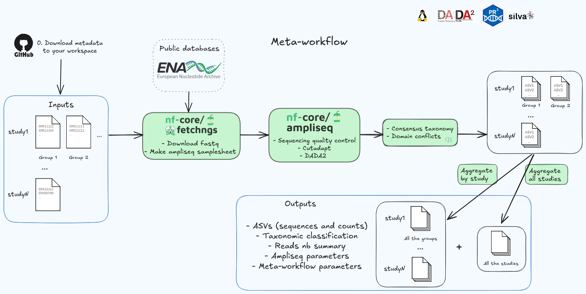

# Meta-workflow

# Introduction

This workflow helps analysing a large volume of metabarcoding data from different studies. The goal is to put together metabarcoding data from various environments that share a similer primer. The unit of analysis is the study, where a study corresponds to one or more publicly available datasets linked to scientific publications. In parallel of the workflow, we manually check the studies to see if they meet certain criteria. This workflow is linked to the [metadata workflow](https://github.com/li0ni0/jedi_metadata) developped to gather metadata on the studies. The metadata downloaded from public databases and can be manually curated.

Type of data considered:  

- For this first version, the DNA must be amplified with the universal primers (5'-GTGYCAGCMGCCGCGGTAA-3' and 926R (5'-CCGYCAATTYMTTTRAGTTT-3')  [(Parada, Needham, & Fuhrman, 2016)](https://pubmed.ncbi.nlm.nih.gov/26271760/), targeting the V4-V5 region of the small subunit rRNA gene and which allows the amplification of 16S rRNA (_Bacteria, Archaea_) as well as 18S rRNA (_Eukaryota_).  

- paired end sequencing



_Schematic flowchart_


## Overview of the steps

1. [nf-core fetchngs pipeline](https://nf-co.re/fetchngs/1.13.0/docs/usage)  
    - Downloads fastq from public databases ([ENA](https://www.ebi.ac.uk/ena/browser/home))  
    - Makes appropriate inputs for ampliseq  
2. [nf-core ampliseq pipeline](https://nf-co.re/ampliseq/3.0.0/)  
    - Sequencing quality control (FastQC)
    - Cutadapt (primer removal)  
    - [DADA2](https://benjjneb.github.io/dada2/index.html) (Divisive Amplicon Denoising Algorithm 2):
        - Amplicon Sequence Variants (ASVs) inferring  
        - Taxonomical classification (reference databases: [PR2](https://pr2-database.org/) and [SILVA](https://www.arb-silva.de/))  
3. Consensus taxonomy between PR2 and SILVA  
4. Formatted, reproducible archive for each study and one for all the studies aggregated together.  


In the same study, the runs can have differences that constrains us to analyse them separatly in ampliseq. Different **groups** are made inside a study for this purpose.   

When different sequencing technologies are used in a study, one group is made for each of them. Indeed, some produces binned quality scores. We want to indicate the binned quality scores in ampliseq parameters because dada2 needs them to calculate its error model.
(If other groups are needed for different reasons, they must be made manually.)  
The workflow creates one parameter file per group but they need to be modified manually.  

The outputs of the groups of a same study are then put together to have one output per study.  
Thus, the groups run separately but must be comparable.  


## Usage

```
sbatch main.sh
```

```
sbatch main.sh -a "add_new_studies.txt" -c "yes" 
```

## Options

**-h**  to print the help  

**-a**  (Optional) Path to a file listing the studies to analyse, one per line.
        By default, the pipelines (fetchngs and ampliseq) will run for every study that has a correct input (see section **Inputs**) and no output folder yet.
        Can be used when ampliseq successfully ran on some studies and you deleted or moved their outputs than added other studies you want to analyse (without running again the ones for which you deleted or moved the output).  
    
**-c**  Use -c "yes" if you want the tables of domain conflicts (domain_conflicts.tsv) for every study.
        Default is "no" and will not create these tables.  
 


## Inputs  


#### General inputs  

To place in the folder **input**:  

- **params_fetchngs.yaml**:
  Parameters file for fetchngs
  
- **studies_traceability.tsv**:  
  Columns:
  - Study_ID
  - Data_accession: bioproject(s) of the study
  - Manuscript: link(s) to the published paper(s) of the study
  - Notes: if the study was discarded and why. Other relevant information.
  
- **param.config**:
  Optionnal, personnalized configuration file for nextflow  

#### Inputs per study 

They must correspond to the outputs of the linked [metadata workflow](https://github.com/JEDI-atlas/jedi_metadata) and be placed in **input/<study_ID>**:   

- **ena_run_metadata.tsv**
- **ena_sample_metadata.tsv** (optional)
- **params_ampliseq_Gi.yaml**:  
  As many files as there are groups, i being the group number.


## Outputs  

Outputs per study, in **output/final_files/per_study\<study_ID\>**:  

- **traceability.tsv**:  
    Copy of input/studies_traceability.tsv

- **input_samples.txt**:  
    Experiment accessions given as inputs for ampliseq  

- **sequences.fasta**:   
    Contains the ASVs IDs and sequences of all the projects   

- [**counts.tsv**](https://nf-co.re/ampliseq/3.1.0/docs/output/#summary-tables):   
    "ASV counts in long format (asv_id, sample, count), zero-count rows dropped. Sourced from DADA2’s raw output, before clustering and any post-processing filters below"   

- [**overall_summary.tsv**](https://nf-co.re/ampliseq/3.1.0/docs/output/#pipeline-information):  
    most_freq_mean_phred_score: 
    Mean sample quality metric: most frequently observed Phred quality across bases (mean for reads 1 and 2) 
    other columns:
    "how many reads per sample passed each pipeline step in which a loss can occur" (see nf-core ampliseq doc)

- **params_ampliseq_Gi.yaml**:  
    Ampliseq parameters, with as many files as groups because they can have different parameters  

- **metaworkflow_params.yaml**:
    Metadata of the meta-workflow; version (tag + ID commit github), options used  

- **taxonomy.R**:
    - \<pr2/silva>_dada2_taxonomy: taxonomy assigned by dada2 assignTaxonomy() based on the database PR2 (resp. SILVA)
    - <pr2/silva>_dada2_confidence: confidence of the last taxonomic rank assigned by dada2, using PR2 (resp. SILVA)  
    - <pr2/silva>_dada2_allConfidences: the confidences of all the assigned taxonomic ranks, using PR2 (resp. SILVA)  
    - consensus_dada2_taxonomy: the taxonomy assigned with either PR2 or SILVA. See consensus rules below  
    - consensus_confidence: confidence of the last taxonomic rank of the consensus taxonomy  
    - consensus_db: "pr2", "silva" or "-" depending on the consensus taxonomy chosen  

  **Rules of the consensus taxonomy**:  
    pr2 is consensus when the ASV is assigned to _Eukaryota_  
    silva is consensus for _Bacteria_ and _Archaea_  
    silva _Mitochondria_ are assigned _Eukaryota:mito_ (consensus_db: "-")  
    silva _Chloroplast_  are assigned _conflict_  (consensus_db: "-")  


- **domain_conflicts.tsv**:  
  Lists the ASVs for which PR2 and SILVA led to different domain assignation with dada2.
    - ASV_ID                         
    - pr2_dada2_taxonomy_domain 	
    - silva_dada2_taxonomy_domain 	
    - pr2_dada2_taxonomy
    - silva_dada2_taxonomy


Outputs for all the studies, in **output/final_files/aggregated**:
The same tables as listed above, except:  

- no domain_conflicts.tsv

- **taxonomy.tsv**:  
  - ASV_ID
  - Studies: column listing all the studies groups where the ASV is found
  - consensus_taxo: consensus of all the consensus taxonomy for the ASV (shortest)
  - consensus_conf: consensus of all the consensus confidences for the ASV (smallest)
  - consensus_db: corresponding to the consensus taxonomy kept (silva or pr2)

    **Rules for the aggregated consensus taxonomy**:  
    When an ASV is present in more than one bio-project, there can be (small) differences in dada2 taxonomic assignation between projects due to "[an element of randomness in the naive Bayesian classifier method that comes from selecting the subsamples of the sequence over which boot strapping assignment is performed"](https://github.com/benjjneb/dada2/issues/1115) and which isn't fixed by setting a seed. Thus, when the taxonomies differ, the shortest one (i.e. with the fewest number of taxonomic level assigned) is kept as consensus over the projects. When the taxonomies are identical but the confidences differ, the smallest confidence value is kept.  


# How to run ?

How to run the pipeline from scratch ?

In the ABIMS cluster:  

- Clone the github repository
- Download the metadata you want to analyse from the [metadata repository](https://github.com/JEDI-atlas/jedi_metadata) (or run it first on new studies). These metadata must be placed in a folder "input", so that the structure is as described in the **Inputs** section.  
- Run the command line __sbatch main.sh__


# Dependencies

This workflow uses:  

- Nextflow: v26.04.4
- nf-core fetchngs: v1.13.0
- nf-core ampliseq: v3.0.0
- R: v4.5.2


## References

### nf-core  

**The nf-core framework for community-curated bioinformatics pipelines.**  
Philip Ewels, Alexander Peltzer, Sven Fillinger, Harshil Patel, Johannes Alneberg, Andreas Wilm, Maxime Ulysse Garcia, Paolo Di Tommaso & Sven Nahnsen.  
Nat Biotechnol. 2020 Feb 13. doi: 10.1038/s41587-020-0439-x.  

**nf-core fetchngs**   
doi: 10.5281/zenodo.5070524  


**nf-core ampliseq**  
doi: 10.5281/zenodo.1493841  

**Interpretations of Environmental Microbial Community Studies Are Biased by the Selected 16S rRNA (Gene) Amplicon Sequencing Pipeline**  
Daniel Straub, Nia Blackwell, Adrian Langarica-Fuentes, Alexander Peltzer, Sven Nahnsen, Sara Kleindienst  
Frontiers in Microbiology 2020, 11:2652 doi: 10.3389/fmicb.2020.550420.  

**The nf-core framework for community-curated bioinformatics pipelines.**  
Philip Ewels, Alexander Peltzer, Sven Fillinger, Harshil Patel, Johannes Alneberg, Andreas Wilm, Maxime Ulysse Garcia, Paolo Di Tommaso & Sven Nahnsen.  
Nat Biotechnol. 2020 Feb 13. doi: 10.1038/s41587-020-0439-x.  

**Universal primers**  
Parada AE, Needham DM, Fuhrman JA. Every base matters: assessing small subunit rRNA primers for marine microbiomes with mock communities, time series and global field samples. Environ Microbiol. 2016 May;18(5):1403-14. doi: 10.1111/1462-2920.13023. Epub 2015 Oct 14. PMID: 26271760.

